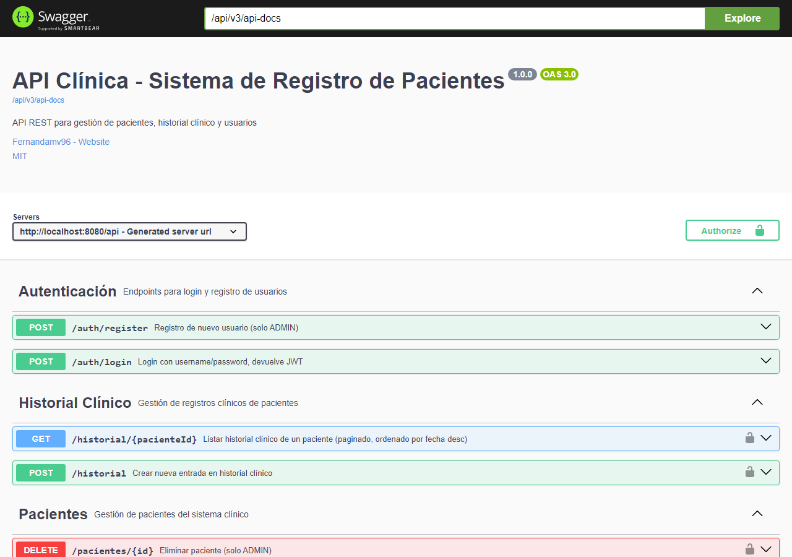

# 🏥 Clínica — API de registro de pacientes

[](https://github.com/Fernandamv96/Clinica-registro-pacientes/actions/workflows/ci.yml)
[](https://github.com/Fernandamv96/Clinica-registro-pacientes/actions/workflows/codeql.yml)


[](LICENSE)

API REST para gestionar **pacientes**, **historial clínico** y **usuarios con roles** en una clínica. La autenticación usa JWT y el control de acceso es por rol (ADMIN, MÉDICO, RECEPCIONISTA).

> ⚠️ **Proyecto educativo / de portafolio.** No usar con datos clínicos reales.



## ¿Qué problema resuelve?

Centraliza el registro de pacientes (con **validación de RUT chileno**) y su historial de atenciones. Cada rol ve y modifica solo lo que le corresponde: recepción registra pacientes, los médicos escriben el historial y la administración gestiona usuarios.

## Stack

| Capa | Tecnología |
|------|-----------|
| Lenguaje | Java 21 |
| Framework | Spring Boot 3.3 (Web, Data JPA, Security, Validation, Actuator) |
| Seguridad | Spring Security + JWT (JJWT 0.12), BCrypt |
| Persistencia | PostgreSQL 16 + Flyway |
| Documentación | SpringDoc OpenAPI (Swagger UI) |
| Tests | JUnit 5, Mockito, AssertJ, Spring Security Test (H2 en memoria) |
| Infra | Docker multi-stage (usuario no-root) + Docker Compose |

## Cómo correrlo localmente

### Con Docker Compose (recomendado)

```bash
cp .env.example .env
# Edita .env: define POSTGRES_PASSWORD y JWT_SECRET (openssl rand -base64 64).
# Opcional: ADMIN_INITIAL_PASSWORD crea el usuario "admin" en el primer arranque.
docker compose up --build
```

- API: http://localhost:8080/api
- Swagger UI: http://localhost:8080/api/swagger-ui.html
- Health: http://localhost:8080/api/actuator/health

Si falta una variable obligatoria, `docker compose` se detiene y te dice cuál es. **No hay credenciales por defecto.**

### Con Maven

```bash
mvn verify                      # compila y corre los tests
export DB_PASSWORD=... JWT_SECRET=...   # más DB_URL / DB_USER si no usas los de por defecto
mvn spring-boot:run
```

### Variables de entorno

| Variable | Obligatoria | Descripción |
|----------|:-----------:|-------------|
| `DB_URL` | no | JDBC URL (por defecto `jdbc:postgresql://localhost:5432/clinica_db`) |
| `DB_USER` | no | Usuario de la BD (por defecto `clinica`) |
| `DB_PASSWORD` | **sí** | Password de la BD |
| `JWT_SECRET` | **sí** | Clave Base64 de ≥ 256 bits |
| `JWT_EXPIRATION_MS` | no | Expiración del token (por defecto 24 h) |
| `ADMIN_INITIAL_PASSWORD` | no | Si se define, crea el usuario `admin` al primer arranque |
| `APP_CORS_ALLOWED_ORIGINS` | no | Orígenes permitidos por CORS, separados por coma (por defecto `http://localhost:*`) |

## Endpoints

Todas las rutas cuelgan de `/api`.

| Método | Ruta | Acceso |
|--------|------|--------|
| POST | `/auth/login` | público → devuelve JWT |
| POST | `/auth/register` | ADMIN |
| GET | `/pacientes` (filtros `rut`, `nombre`, `email`, paginado) | ADMIN, MEDICO, RECEPCIONISTA |
| GET | `/pacientes/{id}` | ADMIN, MEDICO, RECEPCIONISTA |
| POST / PUT | `/pacientes`, `/pacientes/{id}` | ADMIN, RECEPCIONISTA |
| DELETE | `/pacientes/{id}` | ADMIN |
| POST | `/historial` | ADMIN, MEDICO |
| GET | `/historial/{pacienteId}` | ADMIN, MEDICO, RECEPCIONISTA |

Ejemplo:

```bash
TOKEN=$(curl -s -X POST localhost:8080/api/auth/login -H 'Content-Type: application/json' \
  -d '{"username":"admin","password":"<ADMIN_INITIAL_PASSWORD>"}' | jq -r .data.token)

curl -X POST localhost:8080/api/pacientes -H "Authorization: Bearer $TOKEN" \
  -H 'Content-Type: application/json' \
  -d '{"rut":"12.345.678-5","nombreCompleto":"María González","fechaNacimiento":"1985-03-15","sexo":"FEMENINO"}'
```

## Estructura del proyecto

```
src/main/java/com/clinica/
├── config/        SecurityConfig, OpenApiConfig
├── controller/    Auth, Paciente, HistorialClinico
├── dto/           Request/Response por dominio
├── entity/        Paciente, HistorialClinico, Usuario, Rol, BaseEntity (auditoría)
├── exception/     GlobalExceptionHandler + excepciones de dominio
├── repository/    Spring Data JPA
├── security/      JwtService, JwtAuthenticationFilter, DataInitializer
├── service/       Interfaces + impl/
└── util/          RutValidator
src/main/resources/db/migration/   V1__init.sql, V2__seed_dev.sql
src/test/java/com/clinica/         tests unitarios + test de seguridad
```

## Seguridad

- Contraseñas con BCrypt; JWT HS256 sin estado.
- `@PreAuthorize` por rol en cada endpoint; `/auth/register` es solo para ADMIN y tiene un test de regresión.
- Sin secretos en el repo: todo va por variables de entorno (`.env.example`).
- Pipeline con `mvn verify`, CodeQL, Dependabot y gitleaks (pre-commit).

Mira [SECURITY.md](SECURITY.md) para reportar vulnerabilidades.

## Qué aprendí

- A diseñar una API en capas (controller → service → repository) con DTOs y manejo global de errores.
- A configurar Spring Security con JWT y autorización por rol a nivel de método.
- Que un endpoint de registro público con roles elegibles es una **escalada de privilegios**, y a cubrirlo con un test.
- A versionar el esquema de la BD con Flyway y a empaquetar la app en Docker con un usuario no-root.
- Que los secretos nunca deben tener un valor por defecto en el código ni en `docker-compose.yml`.

## Licencia

[MIT](LICENSE) © 2026 Fernanda (Fernandamv96)
